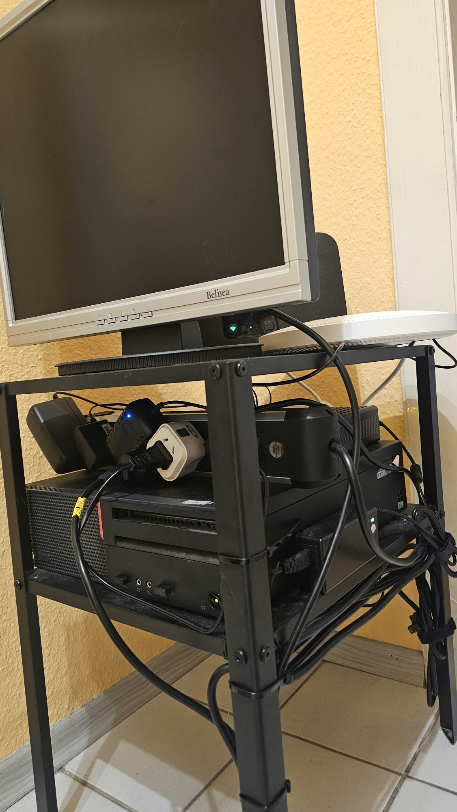
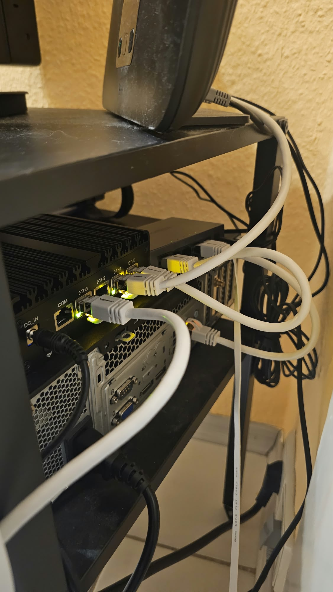

# Hardware

{ width="49%" }
{ width="49%" }

| Gerät | Daten | Aufgabe |
|---|---|---|
| N150 Mini-PC | Intel N150, 8 GB RAM, 4 × RJ45 | OPNsense-Firewall |
| Lenovo ThinkCentre | Intel Core i5-6500 (4C/4T), 32 GB RAM | Proxmox-Host |
| UGREEN CM933 | Managed Switch, 5 Ports | VLAN-Switching |
| TP-Link TL-7AP5100HC-PoE/DC | Access Point | WLAN für Clients, IoT und Gäste |
| Speedport | Telekom-Router | Internet-Uplink |
| MacBook Air 2013 | Intel i5, 4 GB RAM, Ubuntu | Ansible-Control-Node |
| Lenovo Tab M10 Gen 3 | Tablet | Home-Assistant-Dashboard |

**Speicher im Proxmox-Host:** 2 × 256 GB SSD, 1 × 1 TB HDD. Weitere SSDs (500 GB, 256 GB) sind für eine Erweiterung vorgesehen.

**Reserve:** zwei ältere Notebooks als Linux- und Testsysteme.

**Geplant:** separates NAS für Daten und Backups.
