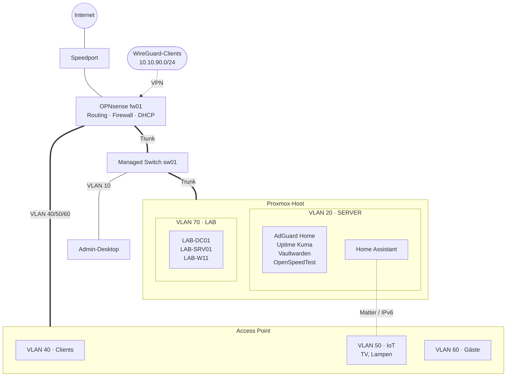

# Homelab

Virtualisierte, segmentierte Testumgebung nach dem Vorbild einer kleinen bis mittelständischen Unternehmens-IT. Sie dient dazu, Netzwerk- und Firewall-Konzepte, Linux- und Windows-Server sowie Automatisierung praktisch umzusetzen. Wo möglich, kommen kostenlose Lösungen und Community-Editionen zum Einsatz.

**Stand:** 04.11.2026

## Highlights

- **6 VLANs** mit restriktivem Firewall-Konzept auf OPNsense: Management, Server, Clients, IoT, Gäste und Lab
- **Smart Home über VLAN-Grenzen:** Matter über IPv6 und mDNS zwischen Server- und IoT-Netz
- **WireGuard-VPN mit minimalen Rechten:** nur ausgewählte Dienste, keine Admin-Oberflächen
- **Monitoring:** Uptime Kuma meldet Ausfälle über Home Assistant aufs Smartphone
- **Active-Directory-Lab:** Domäne mit Dateiserver, AGDLP-Berechtigungen, Gruppenrichtlinien und Windows LAPS in einem isolierten VLAN

## Netzwerkplan

## Technologien

| Bereich | Technologie |
|---|---|
| Virtualisierung | Proxmox VE 9.1 |
| Firewall, Routing, DHCP, VPN | OPNsense mit dnsmasq und WireGuard |
| Netzwerk | UGREEN Managed Switch, TP-Link Access Point |
| DNS | AdGuard Home, Windows Server DNS |
| Windows | Windows Server 2022, Windows 11, Active Directory, Gruppenrichtlinien, Windows LAPS |
| Monitoring | Uptime Kuma |
| Smart Home | Home Assistant, Matter |
| Passwortverwaltung | Vaultwarden |
| Automatisierung | Ansible (im Aufbau) |

## Status

| Bereich | Stand |
|---|---|
| Netzwerk und Virtualisierung | ✅ funktionsfähig |
| Smart Home | ✅ abgeschlossen am 01.11.2026 |
| Windows-AD-Lab | ✅ Grundkonfiguration abgeschlossen am 04.11.2026 |
| Ansible, Storage, Backup | 📋 geplant |
