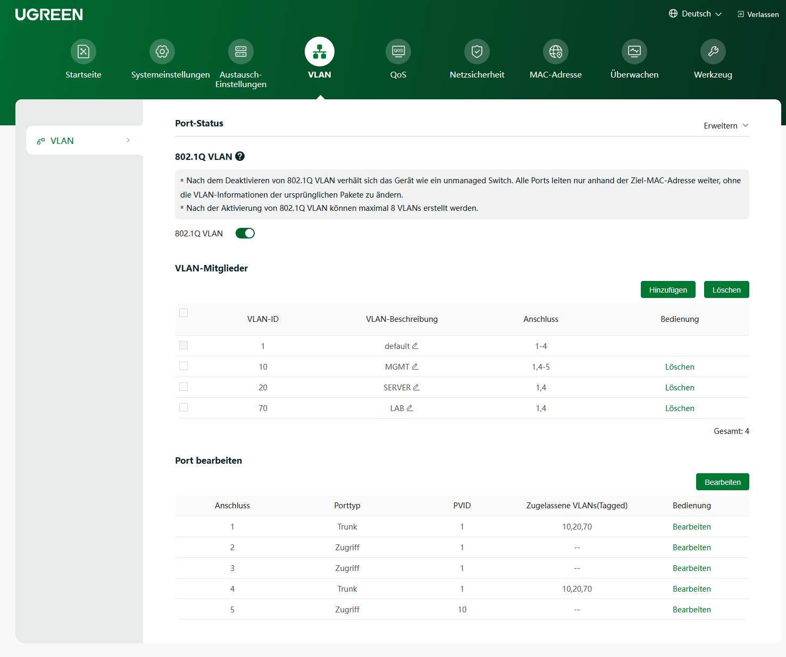
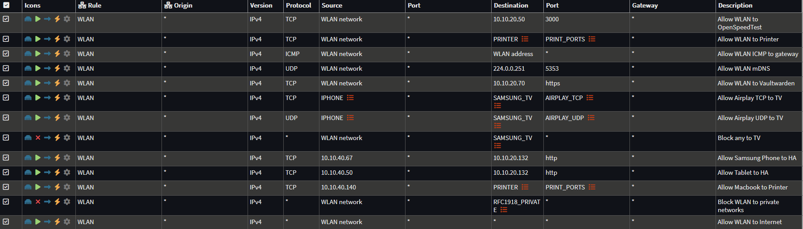

# Netzwerk

## Aufbau

Den Gesamtaufbau zeigt der [Netzwerkplan](index.md#netzwerkplan) auf der Übersicht.

OPNsense übernimmt Inter-VLAN-Routing, Stateful Filtering, NAT, DHCP, DNS für lokale Namen und das VPN. Weil das WAN hinter dem Speedport liegt, entsteht für IPv4 ein doppeltes NAT.

## VLANs

| VLAN | Name | Subnetz | Zweck |
|---|---|---|---|
| 10 | MGMT | `10.10.10.0/24` | Admin-Oberflächen, nur für vertrauenswürdige Geräte |
| 20 | SERVER | `10.10.20.0/24` | DNS, Monitoring, Passwortmanager, Home Assistant |
| 40 | CLIENT | `10.10.40.0/24` | Endgeräte, internes WLAN |
| 50 | IOT | `10.10.50.0/24` | Smart-Home-Geräte und TV, eingeschränkter Zugriff auf interne Netze |
| 60 | GUEST | `10.10.60.0/24` | Gäste, nur Internet |
| 70 | LAB | `10.10.70.0/24` | AD- und Linux-Testumgebung, vom Management getrennt |
| – | APMGMT | `10.10.11.0/24` | Management des Access Points |
| – | WireGuard | `10.10.90.0/24` | VPN-Tunnelnetz (kein VLAN) |

Gateway ist jeweils die `.1` auf OPNsense. Der Access Point hängt direkt an der OPNsense und stellt je ein WLAN für VLAN 40, 50 und 60 bereit. Über den Switch laufen deshalb nur VLAN 10, 20 und 70.

[](bilder/sw_vlan.png)

## Firewall-Prinzip

Freigegeben wird nur, was funktional nötig ist. In restriktiven Netzen gilt diese Regelreihenfolge:

1. Infrastruktur-Dienste erlauben (DNS, NTP, ICMP zur Firewall)
2. Gezielte Zugriffe auf andere VLANs erlauben
3. Private Netze (RFC1918) blockieren
4. Internet erlauben
5. Alles andere blockieren

**Beispiele:**

- Aus dem LAB-VLAN ist die Proxmox-Oberfläche nicht erreichbar (getestet).
- Ein WLAN-Client darf den Drucker im IoT-VLAN nur über TCP 515, 631 und 9100 erreichen.

Regeln des WLAN-VLANs: gezielte Freigaben oben, danach der RFC1918-Block, zuletzt das Internet.

[](bilder/fw_rules.png)

## DNS und DHCP

```text
Client → AdGuard Home (Filterung) → OPNsense/dnsmasq für lokale Namen (home.arpa)
                                  → Upstream-Resolver für externe Domains
```

- DHCP läuft über dnsmasq auf OPNsense. Server und Management-Geräte haben feste Adressen oder Reservierungen.
- Das LAB-VLAN hat einen eigenen Windows-DNS auf dem Domänencontroller, siehe [Windows-AD-Lab](projekte/windows-ad.md).
